# ESP32-C6 多传感器 RS485 采集节点硬件方案报告

日期：2026-05-29

## 1. 结论

本方案建议把每块 ESP32-C6 做成一个独立采集节点：本地接入 GY-302/BH1750 光照模块、DHT22/AM2302 温湿度模块、HC-SR501 PIR 人体红外模块，再通过 3.3V RS485 收发器接入一条 A/B/GND 总线。战舰 V3 侧也外接一块 3.3V RS485 模块作为主站收发器；不要把 P7 上的 `485TX/485RX` 当成 RS485 总线的 `A/B` 端子。

这样做的原因很直接：一个 ESP32-C6 接一套传感器时，TTL UART 可以点对点发送；但两个以上 ESP32-C6 不能把 TX 直接并到战舰 V3 的同一个 RX 上，否则会出现总线争用。RS485 半双工总线适合多个采集节点共线，只要协议规定“主站点名，节点应答”，就能避免同时发送。

供电和 GND 的结论必须单独说明：

1. **ESP32 节点需要独立供电**。战舰 V3 不给两块 ESP32 供电，也不把战舰的 `3.3V` 或 `5V` 拉到 ESP32 节点。每块 ESP32 建议用自己的 USB、5V/VIN 或同一个外部 5V 电源分路供电；若用同一个外部 5V 电源，只能共用 5V 输入和 GND，不要把多个开发板的 `3V3` 输出互相并联。
2. **传感器和本节点 RS485 模块由本节点 ESP32 供电**。BH1750、AM2302、本节点 3.3V RS485 模块接本节点 ESP32 的 `3V3/GND`；HC-SR501 常见模块接本节点 `5V/VBUS/GND`，其 `OUT` 接 ESP32 前必须确认高电平不超过 3.3V。
3. **所有参与通信的 GND 必须连在一起**。战舰 V3 `GND`、战舰侧外置 RS485 `GND`、RS485 总线 `GND`、每块 ESP32 `GND`、每块节点 RS485 `GND`、各传感器 `GND` 都属于同一个参考地网络。这里的“共地”是把所有 `GND` 相连，不是把 `3.3V/5V/VCC` 相连。
4. **RS485 主干只跨节点传 `A/B/GND`**。`A/B` 传差分信号，`GND` 做总线参考地；`3.3V`、`5V`、`VCC` 不作为跨节点电源线。

默认接线如下：

| 功能 | ESP32-C6 引脚 | 外设端子 | 说明 |
|---|---:|---|---|
| BH1750 I2C SDA | GPIO6 / IO6 | SDA | 3.3V I2C |
| BH1750 I2C SCL | GPIO7 / IO7 | SCL | 100 kHz 足够 |
| AM2302 DATA | GPIO11 / IO11 | DATA | DATA 到 3V3 加 4.7k-10k 上拉 |
| HC-SR501 OUT | GPIO10 / IO10 | OUT | 接入前先测 OUT 高电平 |
| RS485 UART TX | GPIO20 / IO20 | DI | ESP32 发送到收发器 |
| RS485 UART RX | GPIO21 / IO21 | RO | 收发器返回 ESP32 |
| RS485 方向控制 | GPIO18 / IO18 | DE 与 /RE | 发送置 1，接收置 0 |
| 本节点 3.3V 电源 | 本节点 ESP32 `3V3` | BH1750、AM2302、本节点 RS485 VCC | 只给本节点小模块供电，不接战舰 3.3V，不接其它 ESP32 的 3V3 |
| 本节点 5V 电源 | 本节点 ESP32 `5V/VBUS` 或外部 5V | HC-SR501 VCC | 常见 HC-SR501 模块用 5V |
| 地 | GND | 本节点所有模块 GND，并接 RS485 总线 GND | 必须和战舰、其它节点共地；只共 GND，不共 VCC |

战舰 V3 主站侧默认外接一块 3.3V RS485 模块。当前实物调试使用 `USART3` 的 `PB10/PB11` 和 `PF12` 方向控制；P7 上的 `485TX/485RX` 不是远端总线的 `A/B`：

| 战舰 V3 侧信号 | STM32F103 管脚 | 接到哪里 | 说明 |
|---|---|---|---|
| `PB10` / USART3_TX | PB10 | 外置 RS485 模块 `DI` | 战舰发送轮询帧 |
| `PB11` / USART3_RX | PB11 | 外置 RS485 模块 `RO` | 战舰接收节点应答 |
| `PF12` / GPIO 输出 | PF12 | 外置 RS485 模块 `DE` 与 `/RE` | 发送前置发送态，发送完成后回到接收态 |
| 战舰 `3.3V` | 3.3V 电源 | 外置 RS485 模块 `VCC` | 选 3.3V RS485 模块 |
| 战舰 `GND` | GND | 外置 RS485 模块 `GND`，并接总线 GND | 与所有节点 GND 相连 |
| 外置 RS485 模块 `A` | 差分总线 | 总线 A 主干 | 接所有 ESP32 节点 RS485 模块的 A |
| 外置 RS485 模块 `B` | 差分总线 | 总线 B 主干 | 接所有 ESP32 节点 RS485 模块的 B |

> 注意：不同 ESP32-C6 开发板排针物理位置不一致。实际接线时按板子丝印找 `GPIO6`、`IO6`、`3V3`、`GND` 等名称，不按本文示意图中的左右位置照搬。
> 战舰 V3 板上可能还有 USB 转串口、RS232、蓝牙/串口、扩展排针等多处 `RX/TX` 丝印。本文默认不用这些口作为多节点总线入口。P7 上的 `485TX/485RX` 是 TTL 侧信号，不是差分 `A/B` 总线。

## 2. 资料归档说明

本报告使用的在线资料已经存入本报告目录下的 `references/` 文件夹。报告正文引用本地归档文件，同时在末尾保留原始在线链接，便于复查。ST 官方下载在本机网络环境下多次超时，因此战舰 V3 相关判断以正点原子资料页、战舰 V3 实物资料、以及 STM32F103ZET6 作为 3.3V MCU 的保守接口处理为准；不把未完整下载的 ST 文件列为有效来源。

本地工程 `esp32-wroom-c6-workspace/main/app_main.c` 已经使用 `GPIO6/GPIO7/GPIO10/GPIO11` 做过单板传感器读取验证逻辑，本文默认引脚与该工程保持一致，并扩展了 RS485 的 `GPIO18/GPIO20/GPIO21`。

## 3. 元件清单与图示依据

下表覆盖本方案的主动模块和开发板。标准电阻、杜邦线、端子线作为辅料，在后续接线图中标出阻值和位置。

| 元件 | 实际图 | 电路图 / 引脚图 |
|---|---|---|
| ESP32-C6-DevKitC-1 / ESP32-C6-WROOM-1 开发板 | 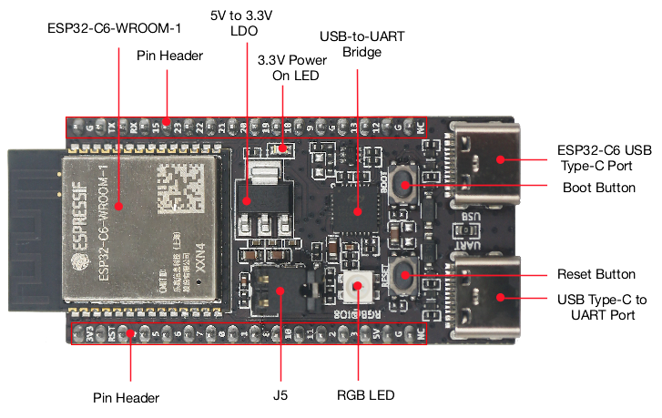 | [官方原理图 PDF](references/esp32-c6-devkitc-1-schematics_v1.4.pdf)，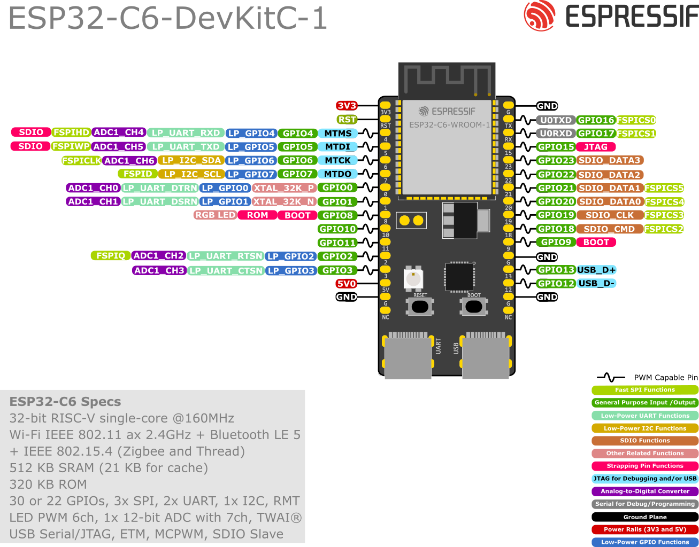 |
| GY-302 / BH1750 光照模块 | 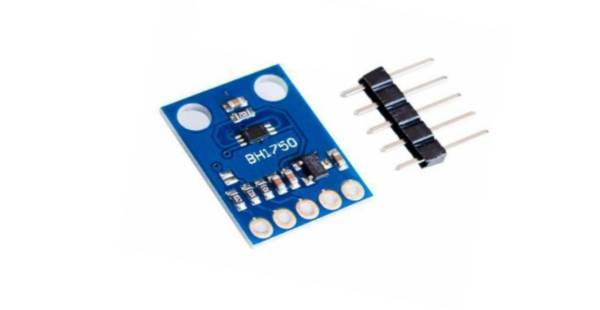 | 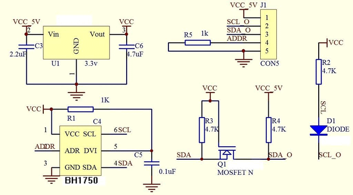，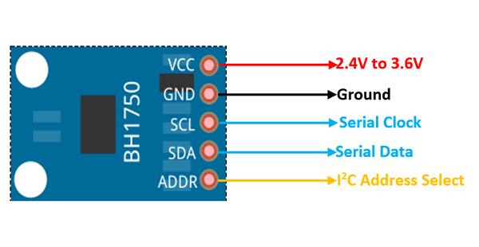 |
| DHT22 / AM2302 温湿度模块 | 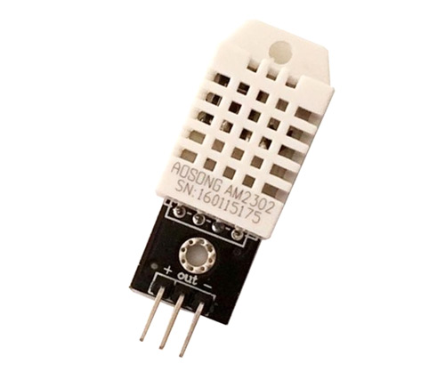 | 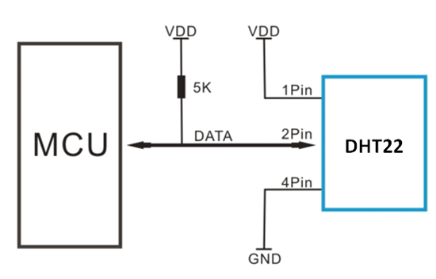，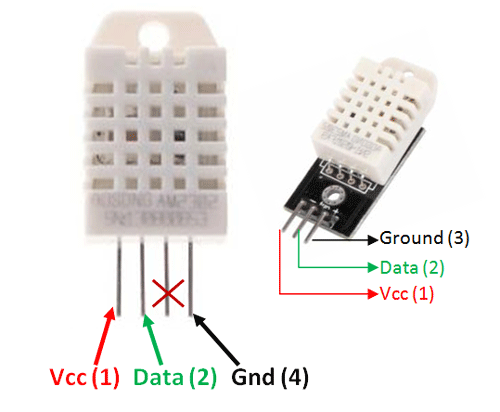 |
| HC-SR501 PIR 人体红外模块 | 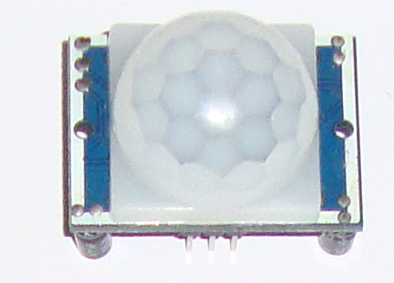 | 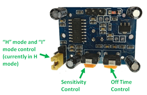，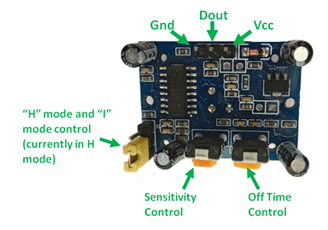 |
| 3.3V RS485 模块 / SP3485 收发器 | 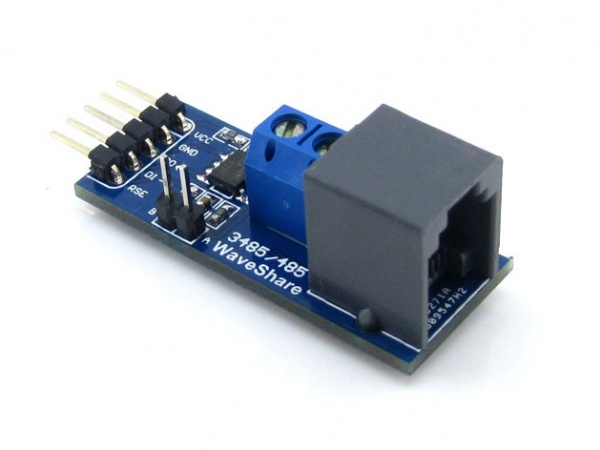 | [Waveshare 模块原理图 PDF](references/waveshare-rs485-board-schematic.pdf)，[SP3485 数据手册](references/maxlinear-sp3485-datasheet.pdf)，[本文局部电路图](sp3485-rs485-local-circuit.svg) |
| 正点原子战舰 V3 / STM32F103ZET6 | 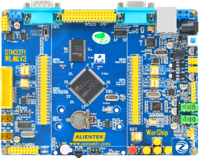 | [正点原子资料页归档](references/openedv-stm32f103-warship-v3.html)，本文给出 RS485 主站接口电路和接线表 |

## 4. 电气兼容性

| 模块 | 供电建议 | 信号电平 | 与 ESP32-C6 兼容性判断 |
|---|---:|---:|---|
| ESP32-C6-WROOM-1 | 模组工作 3.0-3.6V；开发板通常由 USB/5V 转 3.3V | GPIO 为 3.3V 逻辑域 | 外部数字信号按 3.3V 处理。避免让 5V 信号直接进 ESP32-C6 GPIO。 |
| BH1750 / GY-302 | 推荐 3.3V | I2C SDA/SCL 上拉到 3.3V | BH1750 芯片 VCC 典型范围覆盖 3.3V，I2C 与 ESP32-C6 直接兼容。 |
| AM2302 / DHT22 | 本方案推荐 3.3V，短线使用 | 单总线 DATA 上拉到 3.3V | AM2302 支持 3.3-5.5V；用 3.3V 时线长不宜超过约 1m，采样间隔不小于 2s。 |
| HC-SR501 | 常见模块用 5V | OUT 常见约 3.3V，但必须实测 | 模块供电接 5V，OUT 接 ESP32 前用万用表确认高电平不超过 3.3V。若为 5V 输出，必须加分压或电平转换。 |
| SP3485 / 3.3V RS485 | 3.3V | DI/RO/DE/RE 与 3.3V MCU 兼容 | 适合 ESP32-C6。不要把 5V MAX485 模块的 RO 直接接 ESP32-C6，除非确认模块 IO 兼容 3.3V。 |
| 战舰 V3 / STM32F103ZET6 | 开发板自身供电 | MCU 侧按 3.3V TTL 处理 | 当前多节点方案中，战舰侧用外置 3.3V RS485 模块，由 USART3_TX/PB10、USART3_RX/PB11、PF12 驱动。不要把 ESP32 GPIO 接到 DB9 RS232 电平口，也不要把 P7 `485TX/485RX` 当作 `A/B` 总线。 |

ESP32-C6 的启动配置涉及 GPIO8、GPIO9、GPIO15 等 strapping pins。本方案默认传感器和 RS485 控制避开这些启动敏感脚，减少上电状态被外设拉偏的风险。

## 5. 单节点完整电路

先看总图，再按接线表施工。

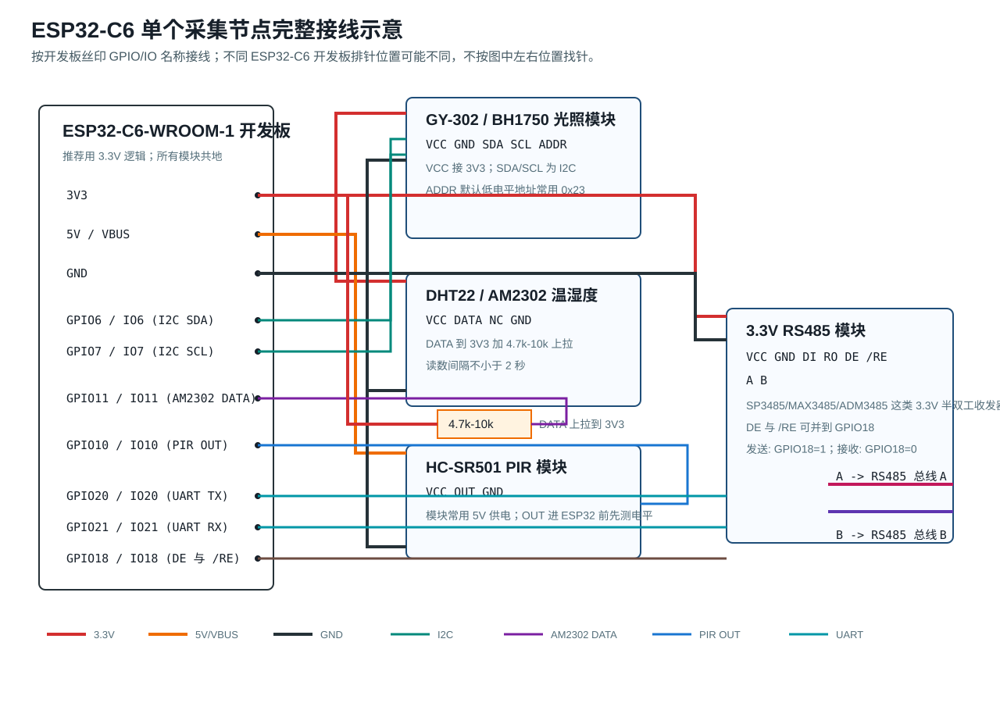

文字版示意如下：

```text
ESP32-C6 开发板丝印/排针              外设模块端子
-----------------------              -----------------------------
3V3  ------------------------------> GY-302/BH1750 VCC
3V3  ------------------------------> AM2302 VCC
3V3  ------------------------------> 3.3V RS485 VCC
5V/VBUS ---------------------------> HC-SR501 VCC
GND  ------------------------------> GY-302/BH1750 GND
GND  ------------------------------> AM2302 GND
GND  ------------------------------> HC-SR501 GND
GND  ------------------------------> RS485 GND

GPIO6 / IO6 -----------------------> GY-302/BH1750 SDA
GPIO7 / IO7 -----------------------> GY-302/BH1750 SCL
GPIO11 / IO11 ---------------------> AM2302 DATA
GPIO10 / IO10 <-------------------- HC-SR501 OUT

GPIO20 / IO20 ---------------------> RS485 DI
GPIO21 / IO21 <-------------------- RS485 RO
GPIO18 / IO18 ---------------------> RS485 DE 与 /RE
RS485 A ---------------------------> RS485 总线 A
RS485 B ---------------------------> RS485 总线 B

AM2302 DATA 与 3V3 之间加 4.7k-10k 上拉电阻。
HC-SR501 OUT 接 ESP32 前，先用万用表测量高电平。
```

模块分组接线表：

| 分组 | 模块端子 | 接到哪里 | 检查点 |
|---|---|---|---|
| BH1750 | VCC | ESP32 3V3 | 不接 5V，避免 I2C 上拉到 5V |
| BH1750 | GND | ESP32 GND | 与 ESP32 共地 |
| BH1750 | SDA | GPIO6 / IO6 | 固件中配置为 I2C SDA |
| BH1750 | SCL | GPIO7 / IO7 | 固件中配置为 I2C SCL |
| BH1750 | ADDR | 悬空或 GND | 默认地址常用 `0x23`；拉高常用 `0x5C` |
| AM2302 | VCC | ESP32 3V3 | 短线实验推荐 3.3V |
| AM2302 | DATA | GPIO11 / IO11 | DATA 到 3V3 加 4.7k-10k 上拉 |
| AM2302 | GND | ESP32 GND | 与 ESP32 共地 |
| HC-SR501 | VCC | 5V / VBUS | 常见模块需要 5V 供电 |
| HC-SR501 | OUT | GPIO10 / IO10 | 先测高电平，确认不超过 3.3V |
| HC-SR501 | GND | ESP32 GND | 与 ESP32 共地 |
| RS485 | VCC | ESP32 3V3 | 选 3.3V RS485 模块 |
| RS485 | GND | ESP32 GND | 同时作为总线参考地 |
| RS485 | DI | GPIO20 / IO20 | ESP32 UART TX |
| RS485 | RO | GPIO21 / IO21 | ESP32 UART RX |
| RS485 | DE、/RE | GPIO18 / IO18 | 两端可并到同一方向控制脚 |
| RS485 | A、B | 总线 A、B | 若通信不通，可只对调一侧 A/B 测试 |

本节点供电关系如下，避免把“谁给谁供电”混在一起。当前实验如果有两块 ESP32，推荐的实物供电是：战舰 V3 用自己的电源或 USB 供电；每块 ESP32 用自己的 USB 或外部 5V 分路供电；每块 ESP32 再给本节点的小模块供电。

| 电源来源 | 被供电对象 | 是否跨节点/接战舰 V3 | 说明 |
|---|---|---|---|
| 战舰 V3 自身电源 | 战舰 V3 主板、战舰侧外置 3.3V RS485 模块 VCC | 不给 ESP32 节点供电 | 战舰 V3 只作为通信主站。战舰 `3.3V` 只给战舰侧外置 RS485 模块使用。 |
| 节点 01 ESP32 的 USB/5V/VIN | 节点 01 ESP32 开发板 | 可与其它节点共用同一个外部 5V 电源分路，但不从战舰取电 | 推荐每块 ESP32 独立 USB；若共用一个 5V 电源，5V 分路供电，GND 共地。 |
| 节点 02 ESP32 的 USB/5V/VIN | 节点 02 ESP32 开发板 | 可与节点 01 共用外部 5V 电源分路，但不并联 `3V3` 输出 | 两块 ESP32 的 `3V3` 输出不要互相连接，也不要接战舰 `3.3V`。 |
| 本节点 ESP32-C6 开发板 `3V3` | 本节点 BH1750 VCC、AM2302 VCC、本节点 3.3V RS485 模块 VCC | 不跨节点，不接战舰 V3 的 3.3V | 只给本节点低功耗 3.3V 模块供电；若 ESP32 重启或读数不稳，改用本节点外部 3.3V 稳压电源。 |
| 本节点 ESP32-C6 开发板 `5V/VBUS` 或本节点外部 5V | 本节点 HC-SR501 VCC | 不跨节点，不接战舰 V3 的 5V | 常见 HC-SR501 需要 5V。若暂时接 3V3 能读到，不代表长期推荐。 |
| RS485 总线 | 只传 A、B、GND 三根线 | 不传 3.3V/5V/VCC | A/B 是差分信号，GND 是参考地；VCC 不作为总线线缆。 |

所有 GND 的关系必须明确：本节点 ESP32 的 `GND`、BH1750 `GND`、AM2302 `GND`、HC-SR501 `GND`、本节点 RS485 模块 `GND` 都接在同一个本地地线上；RS485 总线的 `GND` 再把本节点地与战舰 V3/其它节点的地连成同一个参考地。也就是说，RS485 的 `GND` 不是独立悬空地，而是总线参考地，最终要和战舰 V3 `GND`、每块 ESP32 `GND`、所有模块 `GND` 相连。正电源线仍然分开：战舰 `3.3V/5V` 不接 ESP32 节点，节点之间的 `3V3` 也不互接。

## 6. RS485 局部电路

SP3485 类 3.3V 收发器的局部连接如下：

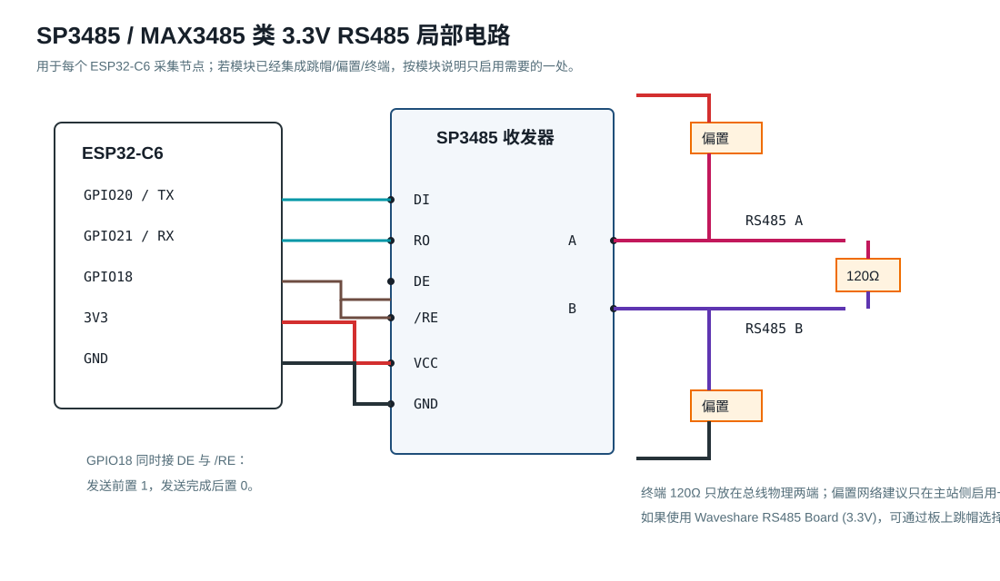

要点：

- `DI` 接 ESP32 `TX`，`RO` 接 ESP32 `RX`。
- `DE` 为发送使能，`/RE` 为接收使能。半双工常见做法是把 `DE` 和 `/RE` 并到同一个 GPIO：发送前置 1，发送完成后置 0。
- `A/B` 是差分总线。不同模块可能把 A/B 命名方向做反，表现通常是超时但不会立刻烧坏。排障时只对调一侧 A/B。
- 120Ω 终端电阻只放在总线物理两端。中间节点不要重复启用终端。
- 偏置电阻只启用一处，优先放主站侧。若购买的模块已有偏置跳帽，先确认跳帽状态。

## 7. 多节点到战舰 V3 的最终接线方案

推荐方案 A：战舰 V3 直接作为 RS485 主站。每块 ESP32-C6 采集节点都是从站。

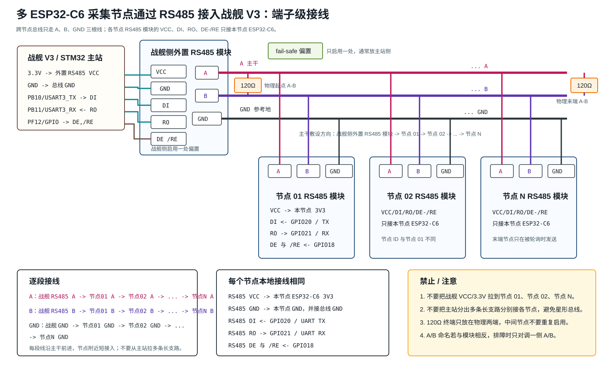

总线文字版示意：

```text
跨节点只连三根线：A、B、GND。不要把主站 3.3V/VCC 拉到各节点。

战舰侧外置 RS485 模块   节点 01 RS485 模块        节点 02 RS485 模块             节点 N RS485 模块
A 端子  -------------> A 端子  ---------------> A 端子  ---- ... -----------> A 端子
B 端子  -------------> B 端子  ---------------> B 端子  ---- ... -----------> B 端子
GND 端子 ------------> GND 端子 --------------> GND 端子 ---- ... ----------> GND 端子

每个节点的 RS485 VCC/DI/RO/DE-/RE 只接本节点 ESP32-C6：
  节点 RS485 VCC       -> 本节点 ESP32-C6 3V3
  节点 RS485 GND       -> 本节点 ESP32-C6 GND，同时接总线 GND
  节点 RS485 DI        <- 本节点 ESP32-C6 GPIO20 / UART TX
  节点 RS485 RO        -> 本节点 ESP32-C6 GPIO21 / UART RX
  节点 RS485 DE 与 /RE <- 本节点 ESP32-C6 GPIO18

只在总线两个物理端点加 120Ω：
  端点 1：A 与 B 之间 120Ω
  端点 2：A 与 B 之间 120Ω
  中间节点不要加 120Ω

主站侧启用一处 fail-safe 偏置；节点侧默认不启用偏置。
```

战舰 V3 主站侧接线：

根据可查到的战舰 V3 资料和本次实物测试，P7 上的 `485TX/485RX` 属于板内 RS485 相关 TTL 侧信号，不是可直接接远端总线的 `A/B` 差分端子。当前可复现方案按实物接线处理：战舰侧外接一块 3.3V RS485 模块，由 `PB10/PB11/PF12` 控制。

| 战舰 V3 / STM32 侧 | 战舰侧外置 RS485 模块或总线 | 说明 |
|---|---|---|
| 战舰 3.3V | 外置模块 `VCC` | 选 3.3V RS485 模块 |
| 战舰 GND | 外置模块 `GND`，同时接总线 GND | 与 ESP32 节点总线 GND 相连 |
| `PB10` / USART3_TX | 外置模块 `DI` | 战舰 V3 发送轮询请求 |
| `PB11` / USART3_RX | 外置模块 `RO` | 战舰 V3 接收节点应答 |
| `PF12` / GPIO 输出 | 外置模块 `DE` 与 `/RE` | 发送前置发送态，发送完成后回到接收态 |
| 外置模块 `A` | 总线 A | 接所有节点 A |
| 外置模块 `B` | 总线 B | 接所有节点 B |

如果只使用板上原有跳帽，则 P7 的作用是把 `PA2` 短接到 `485TX`、把 `PA3` 短接到 `485RX`，相当于处理 USART2 到板内 RS485 相关电路的 TTL 侧连接。它不提供远端 RS485 的 `A/B` 差分接线点。当前工程不走这一路，而是从外置 RS485 模块的 `A/B/GND` 走多节点总线。

战舰侧外置 RS485 模块到各节点 RS485 模块的端子级接线：

| 总线 | 第一段 | 第二段 | 后续节点 | 末端 | 说明 |
|---|---|---|---|---|---|
| A 线 | 战舰侧外置 RS485 `A` -> 节点 01 RS485 `A` | 节点 01 RS485 `A` -> 节点 02 RS485 `A` | 节点 02 `A` -> ... -> 节点 N `A` | 节点 N RS485 `A` | 所有 `A` 端子是同一根 A 主干；若通信一直超时，只对调一侧 A/B 验证。 |
| B 线 | 战舰侧外置 RS485 `B` -> 节点 01 RS485 `B` | 节点 01 RS485 `B` -> 节点 02 RS485 `B` | 节点 02 `B` -> ... -> 节点 N `B` | 节点 N RS485 `B` | 所有 `B` 端子是同一根 B 主干，建议与 A 使用同一对双绞线。 |
| GND 参考线 | 战舰侧外置 RS485 `GND` -> 节点 01 RS485 `GND` | 节点 01 RS485 `GND` -> 节点 02 RS485 `GND` | 节点 02 `GND` -> ... -> 节点 N `GND` | 节点 N RS485 `GND` | 用作总线参考地。各节点本地 ESP32 的 `GND` 也要接到本节点 RS485 `GND`。 |

如果 RS485 模块端子排只有一个 `A/B/GND` 接线孔，不是再从主站拉多条长线到每个节点。正确做法是在每个节点附近用端子排/WAGO/焊接点把“上一段进线”和“下一段出线”并在同一个 `A`、`B`、`GND` 网络上，节点到主干的短支线尽量短。不要做“主站一端分出很多长支路”的星形接法。

各节点 RS485 模块本地接线相同：

| 节点 RS485 模块端子 | 接到本节点 ESP32-C6 | 是否接到主站/其它节点 | 说明 |
|---|---|---|---|
| `VCC` | 本节点 `3V3` | 不接主站 `VCC`，不接其它节点 `VCC` | 每个节点本地供电，避免把 3.3V 当长距离电源总线。 |
| `GND` | 本节点 `GND` | 接总线 `GND` | 本地地与总线参考地相连。 |
| `DI` | `GPIO20 / IO20` | 不接主站 `DI` | ESP32 UART TX 进入本节点收发器。 |
| `RO` | `GPIO21 / IO21` | 不接主站 `RO` | 本节点收发器输出到 ESP32 UART RX。 |
| `DE` 与 `/RE` | `GPIO18 / IO18` | 不接其它节点控制脚 | 两脚可并接；发送前置 1，发送完置 0。 |
| `A` | 不接 ESP32 GPIO | 接主站和所有节点的 `A` | RS485 差分 A 线。 |
| `B` | 不接 ESP32 GPIO | 接主站和所有节点的 `B` | RS485 差分 B 线。 |

RS485 主干施工表：

| 步骤 | 从哪里 | 到哪里 | 说明 |
|---:|---|---|---|
| 1 | 战舰侧外置 RS485 `A` | 节点 01 `A`，再到节点 02 `A`，直到节点 N `A` | 一条连续 A 主干，不做长星形支路 |
| 2 | 战舰侧外置 RS485 `B` | 节点 01 `B`，再到节点 02 `B`，直到节点 N `B` | B 与 A 同路由敷设，优先用双绞线 |
| 3 | 战舰侧外置 RS485 `GND` | 节点 01 `GND`，再到节点 02 `GND`，直到节点 N `GND` | 作为参考地，降低共模漂移 |
| 4 | 物理起点 A/B | 120Ω | 只装在端点 |
| 5 | 物理末端 A/B | 120Ω | 只装在端点 |
| 6 | 主站侧 | 偏置电阻或模块偏置跳帽 | 偏置只启用一处 |

可选方案 B：增加一块 ESP32-C6 网关。网关通过 RS485 轮询采集节点，再通过 3.3V TTL UART 把汇总结果发给战舰 V3。这个方案让战舰 V3 软件更简单，但多一块网关板和一份网关固件。当前若只是课程/实验验证，建议先做方案 A。

明确禁止的接法：

```text
ESP32 节点 01 TX ----+
                     +---- 战舰 V3 USART_RX   不推荐 / 禁止
ESP32 节点 02 TX ----+
```

TTL UART 是点对点接口，多个 TX 直接并联会互相驱动。哪怕软件设计了错峰发送，复位日志、异常输出、上电毛刺也可能抢占线路。

## 8. 默认通信协议

课堂调试和串口助手观察阶段，推荐先用 ASCII 帧，不急着上 Modbus RTU。

```text
主站请求：@Q,ID=03*CS\r\n
节点应答：@D,ID=03,PIR=1,LUX=123.4,T=25.1,H=60.2*CS\r\n
```

字段建议：

| 字段 | 含义 |
|---|---|
| `@Q` | Query，主站查询帧 |
| `@D` | Data，从站数据帧 |
| `ID` | 节点号，建议 `01` 到 `32` |
| `PIR` | HC-SR501 当前触发状态，0 或 1 |
| `LUX` | BH1750 光照值，单位 lux |
| `T` | AM2302 温度，单位摄氏度 |
| `H` | AM2302 湿度，单位 `%RH` |
| `CS` | 校验，调试初期可占位，稳定后用 XOR 或 CRC8 |

轮询策略：

- 默认 `9600 8N1`，短线调试可提高到 `115200 8N1`。
- 主站每次只询问一个 ID，等待 100-300ms；超时记录离线并继续下一个节点。
- AM2302 读数至少间隔 2 秒；节点本地缓存最近一次有效温湿度，主站轮询时直接返回缓存。
- PIR 属于事件/状态量，节点可返回当前电平，也可返回上一个轮询周期内是否触发过。

## 9. 上电与验证流程

上电前：

- 万用表测 3V3-GND、5V-GND，确认无短路。
- 确认正电源没有跨板误接：战舰 `3.3V/5V` 不接 ESP32 节点；节点 01 `3V3` 不接节点 02 `3V3`；RS485 主干不传 `VCC`。
- 确认所有 GND 已经连通：战舰 `GND`、战舰侧 RS485 `GND`、RS485 总线 `GND`、每块 ESP32 `GND`、每块节点 RS485 `GND`、传感器 `GND` 都应是同一个参考地。
- 只给 HC-SR501 上电，测 OUT 高电平。若 OUT 是 5V，先加分压或电平转换，再接 ESP32。
- 确认 GY-302/BH1750 和 AM2302 的 VCC 接 3V3。
- 确认 RS485 模块为 3.3V 型号，或至少确认 `RO/DI/DE/RE` 与 3.3V MCU 兼容。
- 所有节点上电默认 `DE=0`，不要一上电就驱动 RS485 总线。

单节点验证：

1. 只接 ESP32-C6、BH1750、AM2302、HC-SR501，不接 RS485。
2. 用 I2C scanner 或固件日志确认 BH1750 地址，常见为 `0x23`。
3. AM2302 连续读 5 次，间隔不小于 2 秒，温湿度应合理。
4. 触发 HC-SR501，观察 GPIO10 从 0 变 1，并注意模块延时旋钮设置。
5. 串口打印一行数据，例如 `PIR=1,LUX=123.4,T=25.1,H=60.2`。

RS485 验证：

1. 先只接一个 ESP32 节点和一个 USB-RS485 转换器或战舰 V3 主站。
2. 主站发送 `@Q,ID=01*CS`，确认节点应答 `@D,ID=01,...`。
3. 加入第二个节点，配置不同 ID，例如 `02`。
4. 主站轮询 `01`、`02`，确认只有被点名节点打开 `DE` 应答。
5. 启用总线两端 120Ω，确认中间节点终端关闭。
6. 断开节点 02 电源，主站应只记录 02 超时，节点 01 继续正常。

## 10. 最终建议

如果当前只验证一块 ESP32-C6，三类传感器可以直接接在同一块板上，串口日志先跑通。

如果已经确定会有两块或更多 ESP32-C6，并且后续可能扩展到 N 个采集点，从第一版硬件就按 RS485 设计。每个采集节点硬件完全一致，只改节点 ID；战舰 V3 或 ESP32 网关作为主站轮询。这比给战舰 V3 增加多个 UART 更容易扩展，也避免了多个 TTL TX 并联的硬件风险。

推荐落地顺序：

1. 完成单节点三传感器采集。
2. 给单节点加 3.3V RS485 模块，用 USB-RS485 或战舰 V3 轮询。
3. 加第二个节点，验证 ID 和 DE 方向控制。
4. 短线稳定后，再整理端子、终端电阻、偏置跳帽和节点标签。
5. 若现场线长、干扰或不同电源域明显，再升级到隔离 RS485 模块。

## 11. 参考资料

| 资料 | 本地归档 | 在线来源 |
|---|---|---|
| Espressif ESP32-C6-DevKitC-1 User Guide | [esp32-c6-devkitc-1-user-guide.html](references/esp32-c6-devkitc-1-user-guide.html) | <https://docs.espressif.com/projects/esp-dev-kits/en/latest/esp32c6/esp32-c6-devkitc-1/user_guide.html> |
| ESP32-C6-DevKitC-1 Schematic v1.4 | [esp32-c6-devkitc-1-schematics_v1.4.pdf](references/esp32-c6-devkitc-1-schematics_v1.4.pdf) | <https://dl.espressif.com/dl/schematics/esp32-c6-devkitc-1-schematics_v1.4.pdf> |
| ESP32-C6-WROOM-1/WROOM-1U Datasheet | [esp32-c6-wroom-1_wroom-1u_datasheet_en.pdf](references/esp32-c6-wroom-1_wroom-1u_datasheet_en.pdf) | <https://www.espressif.com/sites/default/files/documentation/esp32-c6-wroom-1_wroom-1u_datasheet_en.pdf> |
| ESP-IDF UART Driver for ESP32-C6 | [esp-idf-esp32c6-uart-driver.html](references/esp-idf-esp32c6-uart-driver.html) | <https://docs.espressif.com/projects/esp-idf/en/latest/esp32c6/api-reference/peripherals/uart.html> |
| ESP-IDF I2C Driver for ESP32-C6 | [esp-idf-esp32c6-i2c-driver.html](references/esp-idf-esp32c6-i2c-driver.html) | <https://docs.espressif.com/projects/esp-idf/en/latest/esp32c6/api-reference/peripherals/i2c.html> |
| ROHM BH1750FVI Datasheet mirror | [rohm-bh1750fvi-datasheet.pdf](references/rohm-bh1750fvi-datasheet.pdf) | <https://www.robotpark.com/image/data/PRO/91458/bh1750fvi-e.pdf> |
| Components101 BH1750 Module Notes and Images | [components101-bh1750-ambient-light-sensor.html](references/components101-bh1750-ambient-light-sensor.html) | <https://components101.com/sensors/bh1750-ambient-light-sensor> |
| Aosong AM2302 Technical Manual | [aosong-am2302-technical-manual.pdf](references/aosong-am2302-technical-manual.pdf) | <https://www.aosong.com/uploadfiles/2025/04/20250417105409216.pdf> |
| Components101 DHT22 Module Notes and Images | [components101-dht22-pinout-specs-datasheet.html](references/components101-dht22-pinout-specs-datasheet.html) | <https://components101.com/sensors/dht22-pinout-specs-datasheet> |
| Components101 HC-SR501 Module Notes and Images | [components101-hc-sr501-pir-sensor.html](references/components101-hc-sr501-pir-sensor.html) | <https://components101.com/sensors/hc-sr501-pir-sensor> |
| Waveshare RS485 Board (3.3V) Wiki | [waveshare-rs485-board-3v3-wiki.html](references/waveshare-rs485-board-3v3-wiki.html) | <https://www.waveshare.com/wiki/RS485_Board_(3.3V)> |
| Waveshare RS485 Board User Manual | [waveshare-rs485-board-user-manual.pdf](references/waveshare-rs485-board-user-manual.pdf) | <https://files.waveshare.com/upload/9/95/RS485-Board-UserManual.pdf> |
| Waveshare RS485 Board Schematic | [waveshare-rs485-board-schematic.pdf](references/waveshare-rs485-board-schematic.pdf) | <https://files.waveshare.com/upload/b/bf/RS485-Board-Schematic.pdf> |
| MaxLinear SP3485 Datasheet | [maxlinear-sp3485-datasheet.pdf](references/maxlinear-sp3485-datasheet.pdf) | <https://www.maxlinear.com/document?id=22069> |
| TI RS-485 Design Guide | [ti-rs485-design-guide-slla272d.pdf](references/ti-rs485-design-guide-slla272d.pdf) | <https://www.ti.com/lit/an/slla272d/slla272d.pdf> |
| 正点原子战舰 V3 资料页 | [openedv-stm32f103-warship-v3.html](references/openedv-stm32f103-warship-v3.html) | <http://www.openedv.com/docs/boards/stm32/zdyz_stm32f103_warship.html> |
| 正点原子战舰 V3 RST 原始页面 | [openedv-stm32f103-warship-v3.rst](references/openedv-stm32f103-warship-v3.rst) | <https://raw.githubusercontent.com/alientek-openedv/Products/master/zdyz_docs/boards/stm32/zdyz_stm32f103_warship.rst> |
